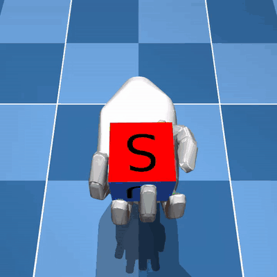
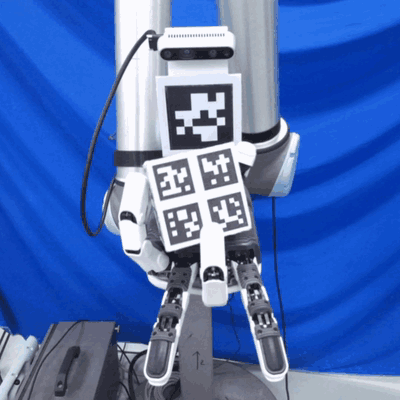
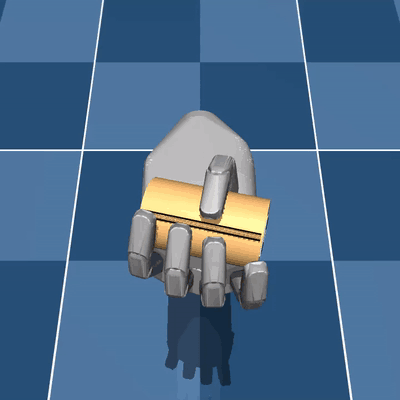
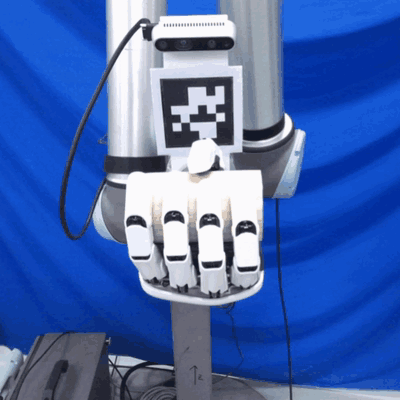

# dexrobot021-mjlab

[中文](README_zh.md)

[](LICENSE)
[](https://www.python.org/downloads/)
[](https://github.com/mujocolab/mjlab)

> In-hand spinning of a cube and a cylinder with the **DexRobot DexHand021** (left
> hand, 12 motors), trained with PPO in [mjlab](https://github.com/mujocolab/mjlab)
> and deployed on the real hand with an external AprilTag camera.

## Demos

<table width="100%">
  <tr>
    <th width="50%">Cube · 70 mm</th>
    <th width="50%">Cylinder · 60 x 100 mm</th>
  </tr>
  <tr>
    <td><br /></td>
    <td><br /></td>
  </tr>
</table>

Top: simulation. Bottom: real hand.

## Overview

The hand is held palm-up and starts every episode already closed around the object.
The policy outputs absolute joint targets for the 12 motors (EMA-filtered like the
hand's own command filter) and is rewarded for the object's rotation rate about one
axis, clipped at 1.5 rad/s and gated on the object staying where it started.
Observations are what the rig can measure: joint positions and velocities, the object
pose and velocities from an AprilTag camera (with a randomised hand-eye error and the
measured latency), and the last action.

What makes it transfer:

- **Drive model in the MJCF.** Each motor is a MuJoCo `<dcmotor>` whose no-load speed
  was measured on the hand; the DIP joints follow the PIP through the hand's
  polynomial linkage (`<equality>`).
- **Episode-start grasps solved against the real objects**, and the same open-then-close
  placement on the rig (`src/dexrobot021_mjlab/assets/grasps.py`).
- **Randomisation** of contact friction (tangential and torsional) and stiffness, joint
  damping/friction, actuator effort, encoder bias, camera extrinsic, and observation
  latency.
- **Hardware-aware penalties**: joint speeds above 1.5 rad/s are penalised, and the
  cylinder policy is fine-tuned to avoid pushing on blocked joints, which latches the
  hand's motor boards.

## Results

| Policy | Object | Simulation, sustained spin (p50) | Real hand |
|---|---|---|---|
| [`checkpoints/spin_cube`](checkpoints/spin_cube) | 70 mm cube, 142.7 g | 1.7 rad/s | 15-26 deg/s net rotation |
| [`checkpoints/spin_cylinder`](checkpoints/spin_cylinder) | 60 x 100 mm cylinder, 118.65 g | 1.9 rad/s | 45-62 deg/s about its own axis, most episodes the full 20 s |

Simulation numbers are from `scripts/eval.py` (256 environments, play configuration).

## Installation

Requirements: Linux x86_64, an NVIDIA GPU (the PyTorch CUDA 12.8 wheels are used), and
[uv](https://docs.astral.sh/uv/).

```bash
git clone https://github.com/Chen-WH/dexrobot021-mjlab.git
cd dexrobot021-mjlab
uv sync                    # training, playback, evaluation
uv run dexrobot021-list    # the registered tasks
```

For the real hand, add the deployment extras (`uv sync --extra deploy`) and see
[Real-robot deployment](#real-robot-deployment).

## Tasks

| Task ID | Object | Notes |
|---|---|---|
| `Dexrobot021-Spin-Cube-v0` | 70 mm cube | Spin about the wrist y axis (across the finger row). From scratch. |
| `Dexrobot021-Spin-Cylinder-v0` | 60 x 100 mm cylinder | Stage 1: spin about the cylinder's own axis as it lies across the palm. From scratch. |
| `Dexrobot021-Spin-Cylinder-Finetune-v0` | same | Stage 2: adds a penalty on pushing blocked joints and a stall termination. **Warm-start only.** |

The tasks are also registered as an `mjlab.tasks` entry point, so mjlab's own
`train` / `play` / `list-envs` see them too.

## Play and evaluate the released policies

```bash
uv run dexrobot021-play Dexrobot021-Spin-Cube-v0 --checkpoint-file checkpoints/spin_cube/model.pt
uv run dexrobot021-play Dexrobot021-Spin-Cylinder-Finetune-v0 --checkpoint-file checkpoints/spin_cylinder/model.pt

# sustained spin rate, joint speeds, actuator saturation
uv run python scripts/eval.py Dexrobot021-Spin-Cube-v0 checkpoints/spin_cube/model.pt
uv run python scripts/eval.py Dexrobot021-Spin-Cylinder-Finetune-v0 checkpoints/spin_cylinder/model.pt
```

Add `--viewer viser` to `play` on a headless machine. Cube and cylinder policies have
the same observation shape, so a checkpoint would load into the wrong task silently;
a guard refuses that.

## Training

Logs go to `logs/rsl_rl/<experiment>/`. The released policies were trained with 2048
environments on one RTX 4070 Ti SUPER (~0.8 s per iteration).

**Cube** (6000 iterations, ~1.3 h; the released policy is iteration 5999):

```bash
uv run dexrobot021-train Dexrobot021-Spin-Cube-v0 --env.scene.num-envs 2048
```

**Cylinder**, two stages. The stage-2 penalties are sized against a policy that
already spins; from scratch they freeze it.

```bash
# stage 1 (6000 iterations)
uv run dexrobot021-train Dexrobot021-Spin-Cylinder-v0 --env.scene.num-envs 2048

# reset the action noise to 0.4 and stage the checkpoint for stage 2
uv run python scripts/reinflate_std.py logs/rsl_rl/spin_cylinder/<run>/model_<N>.pt \
    --task Dexrobot021-Spin-Cylinder-Finetune-v0 --std 0.4

# stage 2 (up to 4000 more iterations)
uv run dexrobot021-train Dexrobot021-Spin-Cylinder-Finetune-v0 --env.scene.num-envs 2048 \
    --agent.resume True --agent.load-run seed --agent.load-checkpoint model_std04.pt
```

The released cylinder policy is iteration 8700, 2700 iterations into stage 2. That run
stopped shortly after on a NaN observation (a rare simulator blow-up); if yours does,
resume from its last checkpoint. Compare checkpoints with `scripts/eval.py`.

## Real-robot deployment

### Hardware

- DexRobot **DexHand021, left**, driven over CAN with DexRobot's `pyzlg_dexhand`
  driver, held **palm-up** and fixed (we used a UR10 as a stand; it is not commanded).
- **Daheng MER2-301-125U3C** (2048x1536, global shutter) with an 8 mm C-mount lens,
  looking at the hand from the side; the object is tracked with it. Needs Daheng's
  Galaxy SDK (`gxipy`).
- **RealSense D435i** on the hand's mounting bracket, used only to calibrate the
  Daheng (its CAD pose relative to the hand is in `scripts/deploy/extrinsic.py`; a
  different bracket needs its own numbers there).
- The printed cube, cylinder and wrist tag from [`hardware/`](hardware/).

`pyzlg_dexhand` and `gxipy` are not on PyPI; install them into the environment from
the vendors.

### Procedure

```bash
# 1. once per lens / focus: Daheng intrinsics from a checkerboard (measure the square)
uv run python scripts/deploy/dahengcal.py --square-mm <measured>

# 2. once per hand: every joint's sign and zero (the hand must be empty; it moves)
uv run python scripts/deploy/verify_hand.py checkpoints/spin_cube

# 3. whenever the camera, wrist tag or mount moves: Daheng + wrist tag in the hand frame,
#    by holding the cube where both cameras see it (use the cube bundle for both objects)
uv run python scripts/deploy/extcal.py checkpoints/spin_cube

# 4. the numpy deployment pipeline reproduces the simulator (no hardware)
uv run python scripts/deploy/selftest.py Dexrobot021-Spin-Cube-v0 checkpoints/spin_cube

# 5. before each session
uv run python scripts/deploy/preflight.py checkpoints/spin_cube --camera --hand

# 6. run (dry run first with --mock)
uv run python scripts/deploy/run.py checkpoints/spin_cube --episodes 3 --trace
uv run python scripts/deploy/run.py checkpoints/spin_cylinder --episodes 3 --trace
```

Each episode: the hand opens to the placement pose, empty; you lay the object onto the
open fingers and let go (the cylinder across the fingers, roughly thumb to little
finger); once it has been still for 2 s and passes the placement checks, the hand
closes to the start grasp and the policy runs for up to 20 s; then you take the
object out. Lay it deep into the palm: an object resting on the fingertips is refused
(`--place-z-tol-mm`). Every run writes a JSON record (and with `--trace` a per-step
`.npz`) next to the bundle.

## Repository layout

```
src/dexrobot021_mjlab/
  assets/        hand and object MJCF + meshes, episode-start grasps
  tasks/inhand/  env config, rewards/observations/events, task registration
  deploy/        numpy runtime: contract, observation, policy, tracker, cameras, hand driver
scripts/         eval.py, reinflate_std.py, deploy/ (export, selftest, calibration, run)
checkpoints/     released bundles: model.pt (rsl_rl), policy.pt / policy.onnx, contract.json
hardware/        printable tags for the cube, the cylinder and the wrist
```

To export a bundle from your own checkpoint:
`uv run python scripts/deploy/export_bundle.py <task> <model_N.pt> -o checkpoints/<name>`.

## Acknowledgements

- [mjlab](https://github.com/mujocolab/mjlab) and [MuJoCo Warp](https://github.com/google-deepmind/mujoco_warp) for simulation, [rsl_rl](https://github.com/leggedrobotics/rsl_rl) for PPO.
- The task recipe follows the in-hand rotation task of [mjlab_hand](https://github.com/ruoyiqiao/mjlab_hand).
- DexHand021 meshes from DexRobot's [dexrobot_urdf](https://github.com/DexRobot/dexrobot_urdf) (Apache-2.0); the cube model and textures from [MuJoCo MPC](https://github.com/google-deepmind/mujoco_mpc) (Apache-2.0); drive parameters after Yuan et al., "Development of the Bioinspired Tendon-Driven DexHand 021 With Proprioceptive Compliance Control", IEEE RA-L, 2026.

## Citation

```bibtex
@software{dexrobot021mjlab2026,
  title  = {dexrobot021-mjlab: In-Hand Spinning with the DexHand021 in mjlab},
  author = {Chen, Weihao},
  year   = {2026},
  url    = {https://github.com/Chen-WH/dexrobot021-mjlab}
}
```

## License

Apache 2.0. See [LICENSE](LICENSE) and [NOTICE](NOTICE).
